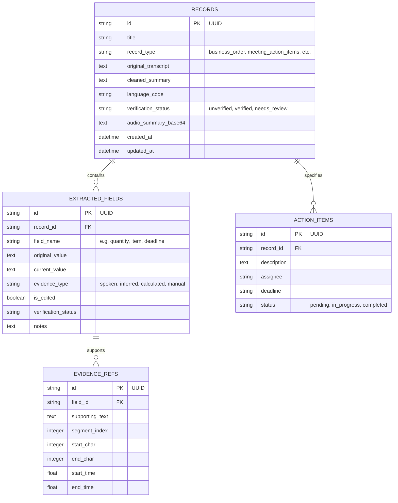

# VaaniTrace System Architecture

---

## 1. High-Level Architecture Overview

VaaniTrace is engineered as a **single, unified full-stack application**. The system serves both the REST API and the production-built React frontend from one FastAPI process.

```
+---------------------------------------------------------------------------------+
|                                 CLIENT TIER                                     |
|  - Web Audio Recorder (HTML5 MediaRecorder)                                     |
|  - Drag-and-Drop Audio Uploader                                                 |
|  - Interactive 2-Panel Evidence Workspace (Transcript <-> Extracted Fields)     |
|  - Spoken Summary Audio Player                                                  |
+---------------------------------------------------------------------------------+
                                      |
                            HTTP / Relative APIs (/api/*)
                                      |
+---------------------------------------------------------------------------------+
|                            APPLICATION SERVER (FastAPI)                         |
|                                                                                 |
|  [ Static Asset Server ]            [ API Routing Tier ]                        |
|  - Serves static/dist/              - /api/health                               |
|  - SPA index.html fallback          - /api/health/gnani                         |
|                                     - /api/transcribe                           |
|                                     - /api/extract                              |
|                                     - /api/speech                               |
|                                     - /api/records [CRUD]                       |
|                                     - /api/records/{id}/export                  |
|                                                                                 |
|  [ Core Services ]                                                              |
|  - GnaniPrismaService (REST v2.5 / v3.0 STT Adapter)                            |
|  - GnaniTimbreService (REST v2.5 / v3.0 TTS Adapter)                            |
|  - InformationExtractor (Domain rules + structured reasoning engine)            |
|  - EvidenceMapper (Substring search, clause alignment, categorization)         |
|  - ExportService (JSON / CSV generators)                                        |
|                                                                                 |
|  [ Data Layer ]                                                                 |
|  - SQLite (Persistent in data/vaanitrace.db)                                    |
|  - SQLAlchemy 2.0 ORM with safe schema initialization                           |
+---------------------------------------------------------------------------------+
                                      |
                        External HTTPS (Async HTTPX)
                                      |
+---------------------------------------------------------------------------------+
|                              GNANI AI CLOUD                                     |
|  - Prisma v2.5 / v3.0 STT Engine (https://api.vachana.ai/stt/v3)                |
|  - Timbre v2.5 / v3.0 TTS Engine (https://api.vachana.ai/api/v1/tts/inference)  |
+---------------------------------------------------------------------------------+
```

---

## 2. Directory Structure

```text
VaaniTrace/
├── app/
│   ├── __init__.py
│   ├── main.py                  # Single application entrypoint & static mount
│   ├── config.py                # Environment & settings via pydantic-settings
│   ├── database.py              # SQLite connection, session factory & engine
│   ├── models.py                # SQLAlchemy DB models (Record, Field, Evidence)
│   ├── schemas.py               # Pydantic v2 schemas for all requests & responses
│   ├── routes/
│   │   ├── __init__.py
│   │   ├── health.py            # /api/health, /api/health/gnani
│   │   ├── transcription.py     # /api/transcribe
│   │   ├── extraction.py        # /api/extract
│   │   ├── speech.py            # /api/speech
│   │   └── records.py           # /api/records CRUD & /export
│   ├── services/
│   │   ├── __init__.py
│   │   ├── gnani_prisma.py      # Gnani Prisma STT service adapter
│   │   ├── gnani_timbre.py      # Gnani Timbre TTS service adapter
│   │   ├── extractor.py         # Structured information extraction engine
│   │   ├── evidence_mapper.py   # Text-to-extraction alignment & evidence linking
│   │   └── export_service.py    # JSON & CSV generation
│   └── utils/
│       ├── __init__.py
│       ├── audio_validation.py  # Audio mime, magic bytes & size validator
│       └── file_storage.py      # Safe temporary file manager & cleanup
├── frontend/
│   ├── package.json
│   ├── tsconfig.json
│   ├── vite.config.ts
│   ├── index.html
│   └── src/
│       ├── main.tsx
│       ├── App.tsx
│       ├── types/index.ts
│       ├── services/api.ts
│       ├── components/
│       │   ├── Header.tsx
│       │   ├── AudioRecorder.tsx
│       │   ├── AudioUploader.tsx
│       │   ├── TranscriptViewer.tsx
│       │   ├── ExtractionPanel.tsx
│       │   ├── EvidenceViewer.tsx
│       │   ├── VerificationControls.tsx
│       │   ├── AudioPlayer.tsx
│       │   ├── RecordCard.tsx
│       │   ├── ErrorAlert.tsx
│       │   └── LoadingOverlay.tsx
│       ├── pages/
│       │   ├── Dashboard.tsx
│       │   ├── Workspace.tsx
│       │   ├── RecordsList.tsx
│       │   ├── RecordDetails.tsx
│       │   └── Settings.tsx
│       └── styles/
│           └── index.css
├── static/                      # Target directory for built frontend assets
│   └── dist/
├── data/                        # Persistent SQLite & temporary upload storage
│   ├── vaanitrace.db
│   └── uploads/
├── tests/
│   ├── __init__.py
│   ├── conftest.py
│   ├── test_health.py
│   ├── test_transcription.py
│   ├── test_extraction.py
│   ├── test_evidence_mapper.py
│   ├── test_records.py
│   ├── test_audio_validation.py
│   └── test_timbre.py
├── docs/
├── .env.example
├── .gitignore
├── requirements.txt
├── package.json                 # Root script runner for unified workflow
└── README.md
```

---

## 3. Database Schema

### 3.1 Tables



---

## 4. Evidence Mapping Workflow

1. **Transcript Ingestion:** User provides audio; Gnani Prisma returns transcript text.
2. **Segmentation:** `EvidenceMapper` divides transcript into indexed sentences/clauses.
3. **Structured Extraction:** `InformationExtractor` produces candidate facts according to domain schemas.
4. **Linkage & Offset Computation:** `EvidenceMapper` matches each fact to its exact passage:
   - Verbatim mentions receive `spoken` tag with exact substring slice.
   - Calculations receive `calculated` tag and reference input fields.
   - Inferences receive `inferred` tag with the relevant reasoning clause.
5. **Interactive UI State:**
   - Active highlight ID synchronizes transcript spans and extraction cards.
   - User edits update `current_value`, switch `evidence_type` to `manual`, but retain `original_value` and evidence spans for full auditability.

